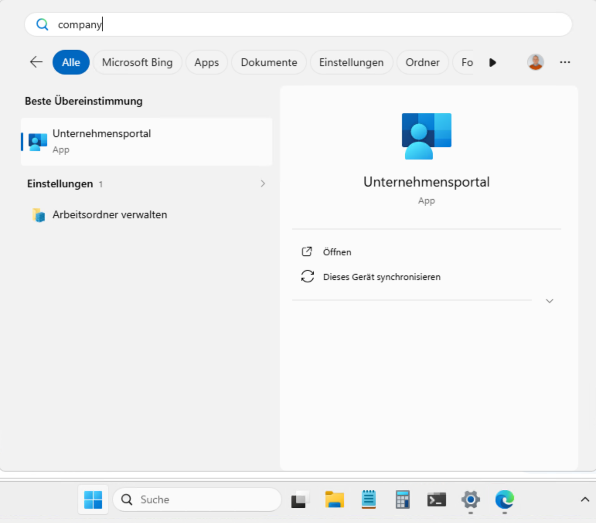

# Intune Remediation: Company Portal Search Shortcut

Author: **Daniel Fraubaum | headsinthecloud.blog**  
Version: **1.1**  
Last update: **2026-11-23**

This folder contains an **Intune Remediation** pair that makes the Company Portal findable in Windows Start search on non-English clients.  
On a German Windows the app is only called **Unternehmensportal**, so users who type `Company Portal` or `Intune` get nothing. The same happens in every other display language.

---

## What this package does

- Creates the shortcut `Intune Company Portal.lnk` in the **All Users** Start Menu (`%ProgramData%\Microsoft\Windows\Start Menu\Programs`)
- The shortcut starts the Company Portal app through Explorer and its AUMID: `explorer.exe shell:AppsFolder\Microsoft.CompanyPortal_8wekyb3d8bbwe!App`
- Takes the app logo from the installed Company Portal package, converts it to `CompanyPortal.ico` and uses it as shortcut icon
- Start search matches on word beginnings, so the one shortcut is found with `intune`, `company` and `portal`
- Skips devices where the Company Portal is not installed
- Recreates the shortcut on every run if it was deleted or changed

---

## Result

On a German Windows 11 client, typing `company` in Start search now returns the Company Portal as best match:



---

## Files

- `Detect_CompanyPortalSearchShortcut.ps1`  
  Detection script. Returns exit code `0` if the shortcut exists, points to the Company Portal and uses the icon (or the app is not installed), `1` otherwise.

- `Remediate_CompanyPortalSearchShortcut.ps1`  
  Remediation script. Extracts the icon and recreates the shortcut.

---

## Why a remediation

Start search finds packaged apps only by their **localized display name**. There is no keyword or alias property for Store apps, and there is **no CSP and no Settings Catalog setting** for it. What Start search does index are `.lnk` files in the Start Menu Programs folders, so an extra shortcut with an English name is the simplest way to steer it.

---

## Parameters

| Parameter | Default | Description |
| --- | --- | --- |
| `$ShortcutName` | `Intune Company Portal` | Name of the shortcut, this is what Start search matches on. Must be the same in both scripts |
| `$AppUserModelId` | `Microsoft.CompanyPortal_8wekyb3d8bbwe!App` | AUMID of the Company Portal app. Must be the same in both scripts |
| `$StartMenuPath` | `%ProgramData%\...\Start Menu\Programs` | All Users Start Menu folder. Must be the same in both scripts |
| `$PackageName` | `Microsoft.CompanyPortal` | Package name, used to skip devices without Company Portal and to find the app logo |
| `$IconFolder` | `%ProgramData%\CompanyPortalSearchShortcut` | Folder for the extracted `CompanyPortal.ico`. Must be the same in both scripts |

You can check the AUMID on a client with:

```powershell
Get-StartApps | Where-Object Name -like "*portal*"
```

---

## Intune setup

1. Go to **Intune admin center**  
   Devices → Scripts and remediations → **Remediations** → **Create**

2. **Settings**  
   - Detection script file: `Detect_CompanyPortalSearchShortcut.ps1`  
   - Remediation script file: `Remediate_CompanyPortalSearchShortcut.ps1`  
   - Run this script using the logged-on credentials: **No** (runs as SYSTEM)  
   - Enforce script signature check: **No**  
   - Run script in 64-bit PowerShell: **Yes**

3. **Assignments**  
   - Assign to the device groups in scope

4. **Schedule**  
   - **Daily**

---

## Notes

- **Two entries in All apps.** Users see both `Intune Company Portal` and `Unternehmensportal` in the app list. Both open the same app.
- **Why Explorer.** A shortcut that targets `shell:AppsFolder\...` directly (without `explorer.exe`) is broken when created with `WScript.Shell`: no icon, and Explorer restarts on every launch. Version 1.0 did that, 1.1 fixes it and replaces the old shortcut automatically.
- **Icon cache.** If Start still shows the old icon after the update, sign out and back in.
- **Search delay.** A new shortcut can take a few seconds until Start search picks it up.
- **Windows 10.** Some Windows 10 builds had a known issue where Start search did not return `.lnk` files at all. Windows 11 is not affected.
- **Removal.** Unassigning the remediation does not delete the shortcut. Remove `Intune Company Portal.lnk` from the All Users Start Menu and the `%ProgramData%\CompanyPortalSearchShortcut` folder if you want it gone.

---

## Disclaimer

These scripts are provided as-is. Test thoroughly in a non-production environment before broad deployment.

---

More Intune content on **[headsinthecloud.blog](https://headsinthecloud.blog)**
