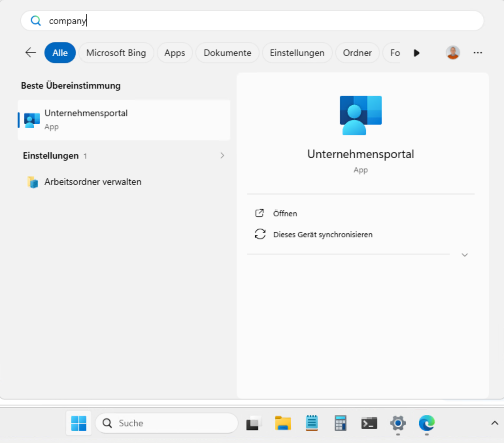

# Intune Remediations

Detection and remediation script pairs for **Intune Remediations** (Devices → Scripts and remediations → Remediations).  
Unless noted otherwise, run them as **SYSTEM** in **64-bit PowerShell**.

| Folder | Description |
| --- | --- |
| [AdobeSecureScoreSettings](./AdobeSecureScoreSettings) | Sets the Adobe Acrobat and Reader DC lockdown settings for Secure Score: Flash off, JavaScript off, Protected Mode on |
| [CompanyPortalSearchShortcut](./CompanyPortalSearchShortcut) | Adds an English-named Company Portal shortcut so Start search finds "Intune" and "Company Portal" on non-English clients  |
| [DisableNetBIOS](./DisableNetBIOS) | Disables NetBIOS over TCP/IP on all active, physical network adapters |
| [EdgeManagedFavorites](./EdgeManagedFavorites) | Merges the Edge managed favorites of several remediations into one sorted favorites tree (`ManagedFavorites` policy). Two variants: device policy for everyone on the device (HKLM) or user policy with only the sets assigned to each user (HKCU), use only one |
| [FixDesktopDeletionRight](./FixDesktopDeletionRight) | Lets standard users delete shortcuts that installers put on the Public Desktop (Users only get "Delete subfolders and files" on `C:\Users\Public\Desktop`) |
| [FixUnquotedServicePaths](./FixUnquotedServicePaths) | Finds and quotes unquoted service paths and uninstall strings |
| [RebootReminder](./RebootReminder) | Shows a modern reboot popup with countdown after X days uptime and enforces the reboot  |
| [SecureBootCertUpdate](./SecureBootCertUpdate) | Opts devices in to the Microsoft managed Secure Boot certificate update and detects the Windows UEFI CA 2023 |
| [ShowFileExtensions](./ShowFileExtensions) | Shows file extensions for known file types in File Explorer. Runs as the **signed-in user** |
| [ShowHiddenFiles](./ShowHiddenFiles) | Shows hidden files and folders in File Explorer (protected OS files stay hidden). Runs as the **signed-in user** |
| [SmartCardRemovalPolicyService](./SmartCardRemovalPolicyService) | Sets the Smart Card Removal Policy service to Automatic (Delayed Start) and starts it |

---

More Intune content on **[headsinthecloud.blog](https://headsinthecloud.blog)**
