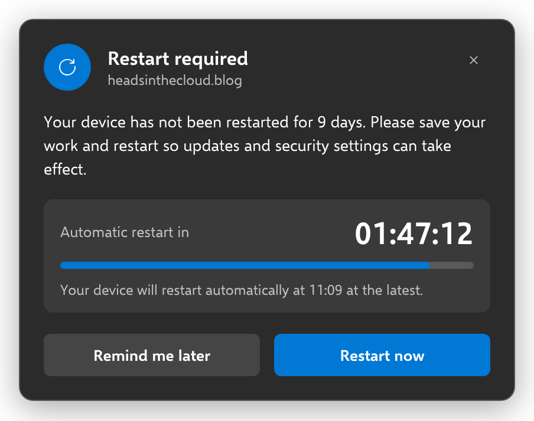

# 🩹 Intune Remediations

Detection and remediation script pairs for **Intune Remediations**. Every folder has its own README with what the package does, the Intune settings, how to test it and what to watch out for.

## 📦 Remediations

| Remediation | Description | Runs as |
|---|---|---|
| [🛡️ AdobeSecureScoreSettings](./AdobeSecureScoreSettings) | Adobe Acrobat and Reader DC lockdown settings for Secure Score: Flash off, JavaScript off, Protected Mode on | SYSTEM |
| [🔎 CompanyPortalSearchShortcut](./CompanyPortalSearchShortcut) | English-named Company Portal shortcut, so Start search finds "Intune" and "Company Portal" on non-English clients  | SYSTEM |
| [🌐 DisableNetBIOS](./DisableNetBIOS) | Disables NetBIOS over TCP/IP on all active, physical network adapters with IP enabled | SYSTEM |
| [⭐ EdgeManagedFavorites](./EdgeManagedFavorites) | Merges the Edge managed favorites of several remediations into one favorites tree, per device (HKLM) or per user (HKCU) | SYSTEM, HKCU set pair as signed-in user |
| [🗑️ FixDesktopDeletionRight](./FixDesktopDeletionRight) | Lets standard users delete shortcuts that installers put on the Public Desktop (only "Delete subfolders and files") | SYSTEM |
| [🔒 FixUnquotedServicePaths](./FixUnquotedServicePaths) | Puts quotes around unquoted service paths with spaces, keeps arguments and logs old and new values | SYSTEM |
| [🔄 RebootReminder](./RebootReminder) | Modern reboot popup with countdown after X days uptime, enforces the reboot  | SYSTEM |
| [🔑 SecureBootCertUpdate](./SecureBootCertUpdate) | Opts in to the Microsoft managed Secure Boot certificate update, plus a detection-only check for the Windows UEFI CA 2023 | SYSTEM |
| [🏷️ ShowFileExtensions](./ShowFileExtensions) | Shows file extensions for known file types in File Explorer | Signed-in user |
| [👁️ ShowHiddenFiles](./ShowHiddenFiles) | Shows hidden files and folders in File Explorer, protected OS files stay hidden | Signed-in user |
| [💳 SmartCardRemovalPolicyService](./SmartCardRemovalPolicyService) | Sets the Smart Card Removal Policy service to Automatic (Delayed Start) and starts it | SYSTEM |

## 🚀 Deployment basics

1. Intune admin center > **Devices** > **Scripts and remediations** > **Remediations** > **Create**
2. Upload `Detect_<Name>.ps1` as detection script and `Remediate_<Name>.ps1` as remediation script.
3. Use the settings from the README of the package. Unless noted otherwise: logged-on credentials **No** (SYSTEM), signature check **No**, 64-bit PowerShell **Yes**, schedule **Daily**.
4. Adjust the **Parameters** block at the top of the scripts first. Values that must be the same in both scripts are marked in the README.
5. Test on one device or a pilot group before you assign it broadly.

## 👤 Author

**Daniel Fraubaum**  
Blog: [headsinthecloud.blog](https://headsinthecloud.blog)  
LinkedIn: [daniel-fraubaum](https://www.linkedin.com/in/daniel-fraubaum-b352ba1aa/)

Use at your own risk. Test in a pilot group before rolling out broadly.
