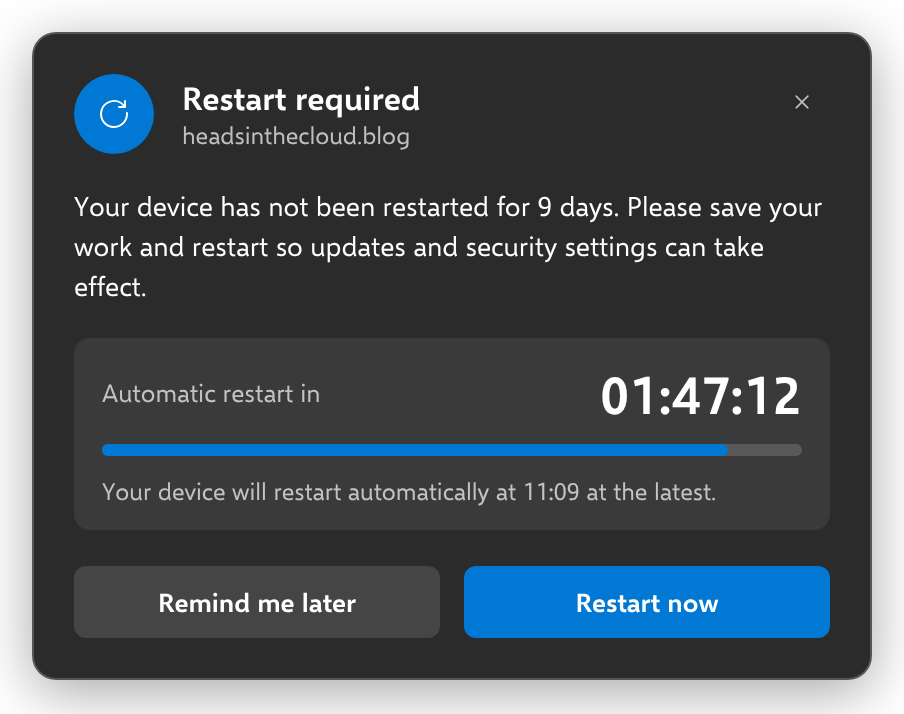
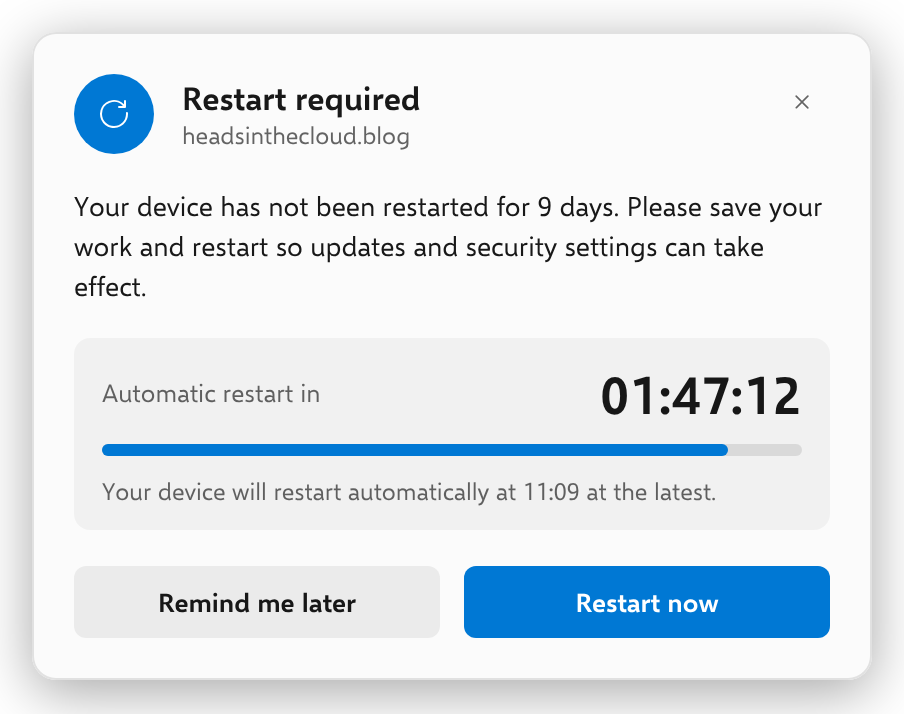
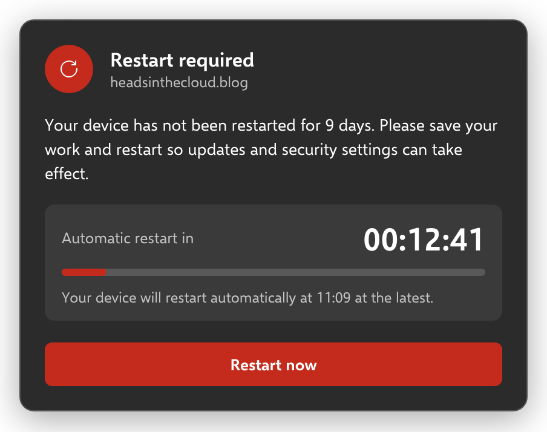

# 🔄 RebootReminder

Windows devices that run for weeks without a restart miss updates and security settings. This remediation pair keeps that from happening.

When a device has been up longer than `$MaxUptimeDays`, the signed-in user gets a modern popup with a live countdown. When the countdown runs out, a SYSTEM task restarts the device, whether or not the user reacted to the popup.

The popup follows the Windows app theme automatically:

| Dark mode | Light mode |
|---|---|
|  |  |

During the last 15 minutes (`$FinalPhaseMinutes`) the popup turns red and can no longer be hidden:



> [!IMPORTANT]
> This remediation **restarts devices**. Test on a pilot group first and tell your users before you roll it out.

## ✨ Features

- Shows a **WPF popup in the bottom right corner** of the screen for every signed-in user
  - Light and dark mode aware (follows the Windows app theme)
  - **Live countdown** with progress bar, based on wall clock time, so sleep or hibernate does not stretch it
  - **Restart now** and **Remind me later** buttons, "later" (and the close button) hides the popup for `$SnoozeMinutes`
  - In the last `$FinalPhaseMinutes` the popup turns red and can no longer be hidden
- **Enforces the reboot** after `$CountdownMinutes` (default 2 hours). Closing or killing the popup does not stop it
- **Reboots right away** (after `$NoUserRebootDelaySeconds`) when nobody is signed in
- **Disables Fast Startup**, because Fast Startup keeps `LastBootUpTime` alive across shutdowns. Without this, a user who "shuts down every evening" never resets the uptime
- Does not restart the countdown on every daily run while a reboot is already scheduled
- Cleans up its scheduled tasks and registry state after the reboot
- Logs to the Intune Management Extension log folder, so **Collect diagnostics** picks it up
- Runs as **SYSTEM** in **64-bit PowerShell** through Intune Remediations

## ⚙️ How it works

| Step | Script | What happens |
|---|---|---|
| 1 | Detect | Reads `LastBootUpTime` and calculates the uptime in full days |
| 2 | Detect | **Uptime below `$MaxUptimeDays`**: the device is compliant. If tasks or registry state from a previous cycle are still there (the device has rebooted since), they are **cleaned up**. Exit `0` |
| 3 | Detect | **Reboot already scheduled in this boot session**, the enforced reboot task exists and the deadline is not overdue by more than `$OverdueGraceMinutes`: nothing to do, exit `0`. This stops the daily run from restarting the countdown |
| 4 | Detect | Otherwise exit `1`, remediation runs |
| 5 | Remediate | If a schedule from this boot session is **overdue** (the enforced reboot did not happen, for example because the task was deleted), the device reboots after `$NoUserRebootDelaySeconds` and the script ends |
| 6 | Remediate | Disables Fast Startup (`HiberbootEnabled = 0` in `HKLM:\SYSTEM\CurrentControlSet\Control\Session Manager\Power`), takes effect with the upcoming reboot |
| 7 | Remediate | Writes the schedule (start time, deadline, uptime) and all popup texts and colors to `HKLM:\SOFTWARE\<OrgPrefix>\RebootReminder` |
| 8 | Remediate | Writes the popup script to `C:\Program Files\<OrgPrefix>\RebootReminder\RebootReminderPopup.ps1` with a locked down ACL. Stops if that folder is a link or not owned by SYSTEM, Administrators or TrustedInstaller (SYSTEM and Administrators full control, Users read and execute only) |
| 9 | Remediate | Replaces the tasks of a previous cycle and registers the enforced reboot task under `\<OrgPrefix>\` in Task Scheduler |
| 10 | Remediate | If **nobody is signed in** (no `explorer.exe`), the device reboots after `$NoUserRebootDelaySeconds` instead of waiting for the countdown. No popup task is registered |
| 11 | Remediate | Registers the popup task and starts it for all signed-in users |

| Task | Runs as | Purpose |
|---|---|---|
| `RebootReminder-EnforcedReboot` | SYSTEM | One-time trigger at the deadline. Runs as soon as possible if the deadline was missed (device asleep or off). Only reboots if the device has not booted since the schedule was created |
| `RebootReminder-Popup` | BUILTIN\Users (each signed-in user) | Shows the popup in every interactive session. Starts right away, again every 15 minutes during the countdown (in case the user killed it) and at logon. A mutex keeps it to one popup per session |

### Why this is not a plain remediation

The obvious approach would be to show the popup and wait for the countdown inside the remediation script itself. That does not work:

- Intune stops Remediation scripts after **about an hour**. A two hour countdown can't run inside the script
- The remediation runs as **SYSTEM** in session 0, so it can't show a window to the user anyway

That's why the remediation only **sets things up** and ends within seconds. The countdown lives in the popup (user context, started by a scheduled task) and the reboot itself is done by a separate **SYSTEM scheduled task**. Both are independent of the Intune script runtime and of each other.

### The popup

- Reads its schedule, texts and colors from `HKLM:\SOFTWARE\<OrgPrefix>\RebootReminder`
- Ends right away if the device has booted since the schedule was created or the deadline has passed
- **Restart now** restarts the device after 10 seconds with `$ShutdownComment`
- When the deadline is reached, it shows `$RestartingText` and leaves the reboot to the SYSTEM task
- Is started through `conhost.exe --headless`, so no console window flashes up

### Cleanup after the reboot

After the reboot the uptime is back to 0. The next detection run sees a compliant device and removes both scheduled tasks and the registry key. The popup script in `Program Files` stays and is overwritten on the next cycle.

## 📋 Requirements

| Requirement | Details |
|---|---|
| Windows | Windows 10 or Windows 11, single-session devices. Exclude multi-session AVD session hosts |
| PowerShell | Windows PowerShell 5.1, 64-bit |
| Context | SYSTEM. The popup runs in the context of each signed-in user through a scheduled task |

## 🔧 Configuration

Adjust the Parameters block at the top of the scripts before you upload them.

> [!IMPORTANT]
> `$MaxUptimeDays` and `$OrgPrefix` **must be the same in both scripts**. Otherwise detection and remediation look at different limits or different registry keys and tasks.

### Both scripts

| Variable | Default | Description |
|---|---|---|
| `$MaxUptimeDays` | `7` | Uptime in days that triggers the reminder. Must be the same in both scripts |
| `$OrgPrefix` | `"headsinthecloud.blog"` | Used for the registry key, the Program Files folder and the Task Scheduler folder. Must be the same in both scripts |
| `$TestUptimeDays` | `$null` | Testing only: fakes the uptime in days. Set to `$null` for production |

### Detection script only

| Variable | Default | Description |
|---|---|---|
| `$OverdueGraceMinutes` | `15` | If a scheduled reboot is overdue by more than this, detection fails again and remediation reboots right away |

### Remediation script only

| Variable | Default | Description |
|---|---|---|
| `$CountdownMinutes` | `120` | Countdown until the enforced reboot |
| `$SnoozeMinutes` | `30` | "Remind me later" hides the popup for this long |
| `$FinalPhaseMinutes` | `15` | During the last X minutes the popup can no longer be hidden |
| `$RebootImmediatelyIfNoUser` | `$true` | Reboot after `$NoUserRebootDelaySeconds` if nobody is signed in |
| `$NoUserRebootDelaySeconds` | `300` | Delay for the reboot without a signed-in user, and for an overdue reboot |
| `$DisableFastStartup` | `$true` | Disables Fast Startup so a shutdown resets the uptime |
| `$CompanyName` | `"headsinthecloud.blog"` | Shown below the title in the popup |
| `$AccentColor` | `"#0078D4"` | Icon, progress bar and "Restart now" button. Keep it dark enough for white button text |
| `$FinalAccentColor` | `"#C42B1C"` | Accent color during the final phase |
| `$TitleText` | `"Restart required"` | Popup title |
| `$MessageText` | `"Your device has not been restarted for {0} days. ..."` | Main text, `{0}` = uptime in days |
| `$CountdownLabelText` | `"Automatic restart in"` | Label next to the countdown |
| `$HintText` | `"Your device will restart automatically at {0} at the latest."` | Hint below the progress bar, `{0}` = deadline time |
| `$ButtonNowText` | `"Restart now"` | Primary button |
| `$ButtonLaterText` | `"Remind me later"` | Secondary button |
| `$RestartingText` | `"Your device is restarting now. Please save your work immediately."` | Shown when the restart starts |
| `$ShutdownComment` | `"Scheduled maintenance restart by IT."` | Comment passed to `shutdown.exe`, visible in the event log |

The registry path, the Task Scheduler folder, the popup path and the log file are built from `$OrgPrefix` below the parameters. You do not need to change them.

The popup reads its texts from the registry, so keep them **ASCII only**. Windows PowerShell 5.1 reads scripts without a BOM as ANSI, and Intune Remediations run in Windows PowerShell 5.1.

## 🚀 Deployment

Intune admin center > **Devices** > **Scripts and remediations** > **Remediations** > **Create**

Basics:

- Name: `Reboot Reminder - Enforced reboot after 7 days uptime`
- Description: Shows a reboot popup with countdown and enforces the reboot

| Setting | Value |
|---|---|
| Detection script file | `Detect_RebootReminder.ps1` |
| Remediation script file | `Remediate_RebootReminder.ps1` |
| Run this script using the logged-on credentials | No (SYSTEM) |
| Enforce script signature check | No |
| Run script in 64-bit PowerShell | Yes |
| Assignment | Device groups, not user groups. Exclude multi-session AVD session hosts |
| Schedule | Daily |

**Exclude multi-session AVD** session hosts. An enforced reboot would kick every user off the host, and the "nobody signed in" check does not fit a multi-session host. Use an exclude group or an assignment filter with this rule, set to **Exclude**:

```
(device.operatingSystemSKU -eq "ServerRdsh")
```

## 🧪 Testing

Test on a **VM or a test device**. The device **will restart**.

1. In `Remediate_RebootReminder.ps1` set:

   ```powershell
   $TestUptimeDays = 10
   $CountdownMinutes = 5
   ```

2. Sign in to the test device with a normal user account.
3. Run the remediation as SYSTEM with [PsExec](https://learn.microsoft.com/sysinternals/downloads/psexec) from an elevated prompt:

   ```
   psexec -s C:\Windows\System32\WindowsPowerShell\v1.0\powershell.exe -NoProfile -ExecutionPolicy Bypass -File C:\Temp\Remediate_RebootReminder.ps1
   ```

4. The popup appears in the bottom right corner within a few seconds. Check the tasks under `\headsinthecloud.blog\` in Task Scheduler.
5. After 5 minutes the SYSTEM task reboots the device.
6. After the reboot, run the detection script the same way to verify the cleanup (tasks and registry key removed):

   ```
   psexec -s C:\Windows\System32\WindowsPowerShell\v1.0\powershell.exe -NoProfile -ExecutionPolicy Bypass -File C:\Temp\Detect_RebootReminder.ps1
   ```

With `$CountdownMinutes = 5` the countdown is shorter than `$FinalPhaseMinutes` (15), so the popup starts directly in the red final phase without "Remind me later". To test snoozing, also set `$FinalPhaseMinutes = 2`.

> [!IMPORTANT]
> Set `$TestUptimeDays` back to `$null` and `$CountdownMinutes` back to `120` before uploading. If `$TestUptimeDays` stays set in the detection script, the device never becomes compliant and reboots every day.

## 📝 Logging

| Log | Location | Content |
|---|---|---|
| Detection and remediation | `C:\ProgramData\Microsoft\IntuneManagementExtension\Logs\RebootReminder.log` | Uptime, deadline, registered tasks, cleanup, errors. Lines are tagged `[Detect]` or `[Remediate]`. Collected by **Collect diagnostics** in Intune |
| Popup | `%TEMP%\RebootReminderPopup.log` of the signed-in user | Popup start, snooze, final phase, "Restart now" clicks |
| Reboot | Event Viewer > Windows Logs > System, event ID **1074** | Who triggered the restart, with the `$ShutdownComment` |
| Intune | Remediation dashboard, device status | The pre-remediation and post-remediation detection output shows the uptime and the scheduled deadline |

State and tasks for troubleshooting (default `$OrgPrefix`):

- Registry: `HKLM:\SOFTWARE\headsinthecloud.blog\RebootReminder`
- Task Scheduler: `\headsinthecloud.blog\RebootReminder-EnforcedReboot` and `\headsinthecloud.blog\RebootReminder-Popup`
- Popup script: `C:\Program Files\headsinthecloud.blog\RebootReminder\RebootReminderPopup.ps1`

| Exit code | Meaning |
|---|---|
| `0` | Detect: uptime below the limit, or a reboot is already scheduled for this boot session. Remediate: popup and enforced reboot scheduled, or reboot started (nobody signed in, or overdue schedule) |
| `1` | Detect: uptime limit exceeded, or the check failed. Remediate: setup failed, see the log |

## ⚠️ Good to know

- **Devices restart.** Tell your users before you roll this out and test on a pilot group first.
- **Popup in Program Files.** Standard users can create folders in `C:\ProgramData` and then own them. A user could create the popup folder there in advance and swap the popup script, which runs in the session of every signed-in user. `C:\Program Files` does not allow that. Earlier versions used `C:\ProgramData\<OrgPrefix>\RebootReminder`, that folder is no longer used and can be deleted.
- **Same values in both scripts.** `$MaxUptimeDays` and `$OrgPrefix` must match, otherwise detection and remediation look at different limits, keys and tasks.
- **Testing values.** `$TestUptimeDays` must be `$null` in production. Left set in the detection script, the device never becomes compliant and reboots every day.
- **ASCII only texts.** Windows PowerShell 5.1 reads scripts without a BOM as ANSI, so non-ASCII characters in the popup texts break.
- **Fast Startup stays off.** The remediation sets `HiberbootEnabled = 0` and never turns it back on. Set `$DisableFastStartup = $false` if you manage Fast Startup elsewhere, but then a shutdown does not reset the uptime.
- **Forced restarts.** The enforced reboot, the reboot without a signed-in user and the overdue reboot use `shutdown.exe /r /f`, so unsaved work in open apps is lost. The enforced reboot task gives 60 seconds.
- **Device off at the deadline.** The enforced reboot task runs as soon as possible after the device is back. It does nothing if the device has booted since the schedule was created.
- **Uptime counts full days.** A device that has been up 6.9 days counts as 6 days.
- **Multi-session AVD.** Exclude session hosts, an enforced reboot would kick every user off the host.

## 🛠️ Troubleshooting

| Symptom | Check |
|---|---|
| No popup after the remediation ran | `RebootReminder.log` shows "Popup task registered and started". The task `RebootReminder-Popup` exists. Popup log `%TEMP%\RebootReminderPopup.log` of the user |
| Device restarts every day | `$TestUptimeDays` is still set in the detection script |
| Device restarts right after the remediation | Nobody was signed in (no `explorer.exe`), or the previous schedule was overdue. The log shows which one |
| Countdown starts again on the next daily run | The task `RebootReminder-EnforcedReboot` or the registry state was removed. Detection only skips the run when both exist |

## 👤 Author

**Daniel Fraubaum**  
Blog: [headsinthecloud.blog](https://headsinthecloud.blog)  
LinkedIn: [daniel-fraubaum](https://www.linkedin.com/in/daniel-fraubaum-b352ba1aa/)

Use at your own risk. Test in a pilot group before rolling out broadly.
