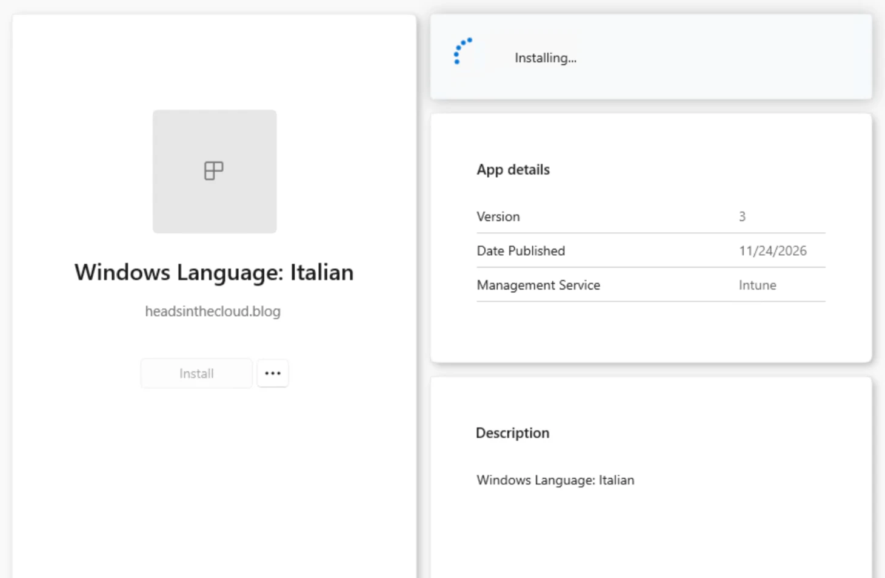
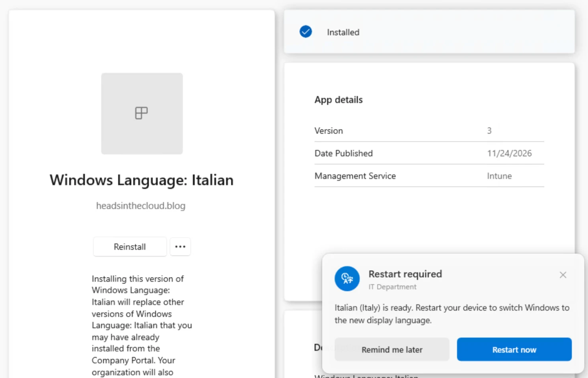
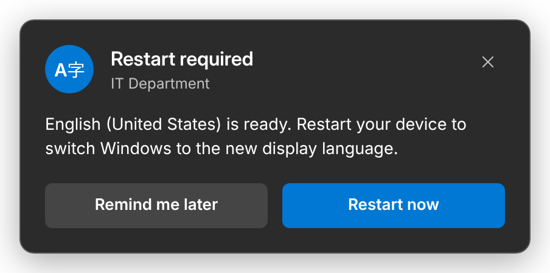
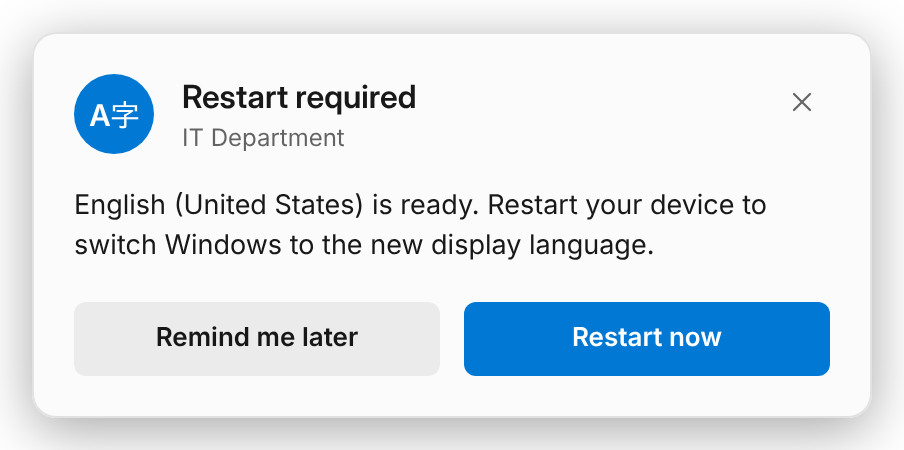
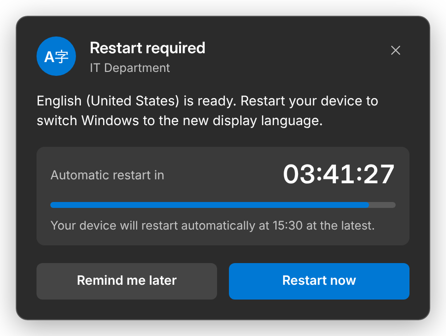
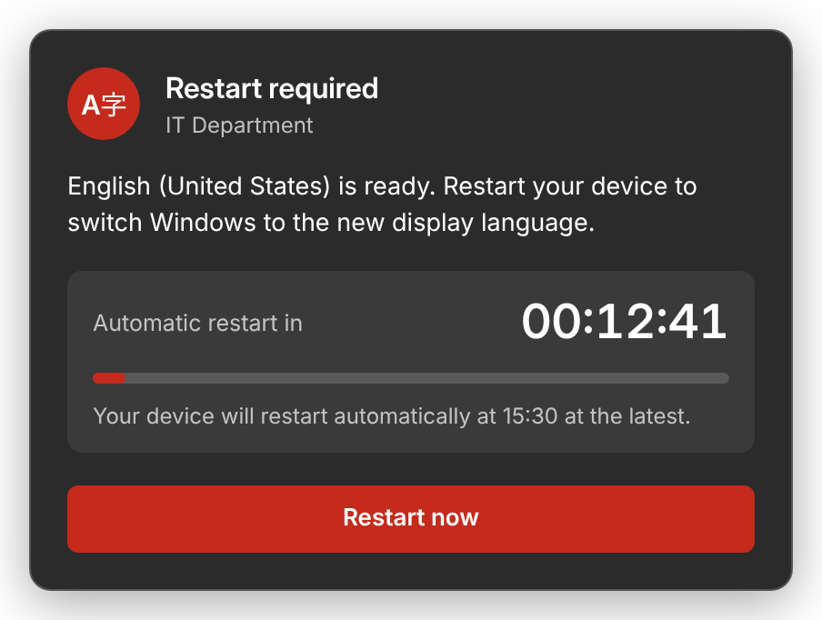

# 🌍 Set-DeviceLanguage

Switch the Windows 11 display language, regional format and country/region with a single Intune Win32 app. One package covers both scenarios: set the language once during Autopilot, and let users change it themselves from the Company Portal with one click.

No Store Local Experience Packs, no Administrative Template policies that lock users in, no message boxes with a 24 hour shutdown timer. The script installs the language with `Install-Language`, applies it to the system, the Welcome screen, new profiles and the signed-in user, and reminds the user to restart with a popup in the bottom right corner.

## ✨ Features

- Installs the language pack and language features on demand (skips the download only if the UI language pack is really there, leftovers from a failed installation do not count)
- Sets display language, preferred language list, regional format, country/region and system locale
- Copies the settings to the Welcome screen and to new user profiles
- Applies the settings to the signed-in user through a one-time scheduled task in user context
- Keeps existing languages and keyboard layouts of the user, the new language is only moved to the top
- Works with no user signed in (Autopilot ESP device phase) and with a signed-in user (Company Portal)
- Two separate detection markers, so the Autopilot app never overrides the user's later choice
- Checks all prerequisites before changing anything
- Logs to the Intune Management Extension log folder, so "Collect diagnostics" picks it up
- Restart reminder popup in the bottom right corner after a Company Portal install, shown again until the device is restarted (no IME toast)
- Optional enforced restart with live countdown, set per app on the command line
- Returns `3010` during Autopilot or when nobody is signed in, the restart is handled by Intune
- Does not collide with cumulative updates: waits for running servicing operations and returns `1618` (retry) instead of failing

## ⚙️ How it works

| Step | Context | What happens |
|---|---|---|
| 1 | SYSTEM | Prerequisite checks (64-bit, admin, Windows 11 22H2+, module, valid tags) |
| 2 | SYSTEM | If the UI language pack is missing (`Get-InstalledLanguage` shows no `LpCab` or `Lxp`): check for a pending reboot (not with `-InitialSetup`), wait for running servicing operations, then `Install-Language`, second attempt after 5 minutes if it fails or the language pack is still missing afterwards |
| 3 | SYSTEM | Display language, language list, regional format, country/region and system locale for the SYSTEM account |
| 4 | SYSTEM | `Copy-UserInternationalSettingsToSystem` to the Welcome screen and new user profiles |
| 5 | User | For every signed-in user: one-time scheduled task that sets language list, display language, regional format and country/region |
| 6 | SYSTEM | Detection marker in the registry |
| 7 | SYSTEM | Restart reminder, only if a user is signed in and `-InitialSetup` is not set: popup task for all users, cleanup task at the next startup, optional enforced restart task |
| 8 | Intune | Exit code `0` with restart reminder, otherwise `3010`. Exit code `1618` if the installation has to be retried |

If nobody is signed in, steps 5 and 7 are skipped. The first user who signs in after the restart gets the settings from step 4.

## 📋 Requirements

| Requirement | Details |
|---|---|
| Windows | Windows 11 22H2 (build 22621) or later |
| PowerShell | Windows PowerShell 5.1, 64-bit |
| Module | `LanguagePackManagement` (built into Windows 11) |
| Context | SYSTEM (Win32 app install behavior: System) |
| Network | Access to Windows Update / Features on Demand for the language download |

## 🔧 Configuration

Before packaging, adjust the configuration block at the top of the script. These values are the same for every app and are not passed on the command line.

| Variable | Default | Description |
|---|---|---|
| `$MarkerKeyPath` | `HKLM:\SOFTWARE\CompanyName\DeviceLanguage` | Registry key for the detection markers. Set this to your own company key. |
| `$MarkerValueName` | `Language` | Marker for the Company Portal apps (last selected language) |
| `$InitialMarkerValueName` | `InitialLanguage` | Marker for the Autopilot app (only written with `-InitialSetup`) |
| `$WorkingFolder` | `%ProgramFiles%\CompanyName\DeviceLanguage` | Folder for the temporary user script and the restart reminder popup. Replace `CompanyName` with your company name, as in `$MarkerKeyPath`. The user script is removed after the run, the popup at the next startup |
| `$LogFile` | `%ProgramData%\Microsoft\IntuneManagementExtension\Logs\Set-DeviceLanguage.log` | Log file |
| `$UserTaskTimeoutSeconds` | `300` | Maximum wait time for the user part |
| `$RetryExitCode` | `1618` | Exit code for "try again later". Intune maps `1618` to Retry by default |
| `$ServicingWaitMinutes` | `10` | Maximum wait time for running servicing operations before `Install-Language` |
| `$ServicingCheckIntervalSeconds` | `30` | Check interval while waiting |
| `$ServicingProcessNames` | `TiWorker` | Processes that indicate an active servicing operation |
| `$InstallRetryWaitMinutes` | `5` | Wait time before the second `Install-Language` attempt |
| `$PopupFileName` | `LanguageRestartPopup.ps1` | Popup script, must be in the package next to `Set-DeviceLanguage.ps1` |
| `$ReminderRegPath` | `<MarkerKeyPath>\RestartReminder` | Schedule, texts and colors for the popup |
| `$TaskPath` | `\DeviceLanguage\` | Task Scheduler folder for the reminder tasks |
| `$FinalPhaseMinutes` | `15` | With an enforced restart: during the last X minutes the popup can no longer be hidden |
| `$CompanyName` | `IT Department` | Shown below the popup title. Set this to your company or IT team |
| `$AccentColor` / `$FinalAccentColor` | `#0078D4` / `#C42B1C` | Icon, progress bar and button color, normal and final phase |
| `$TitleText`, `$MessageText`, `$CountdownLabelText`, `$HintText`, `$ButtonNowText`, `$ButtonLaterText`, `$RestartingText` | English texts | Popup texts. `{0}` in `$MessageText` is the language name, `{0}` in `$HintText` the restart time. ASCII only |
| `$ShutdownComment` | `Restart to apply the new Windows display language.` | Comment of the restart, visible in the System event log (event ID 1074) |

## 🎛️ Parameters

| Parameter | Required | Example | Description |
|---|---|---|---|
| `-Language` | Yes | `en-US` | Display language to install and apply |
| `-Culture` | No | `de-AT` | Regional format for date, time, numbers and currency. Defaults to `-Language` |
| `-GeoId` | No | `14` | Country or region. `0` or not set leaves it unchanged |
| `-InitialSetup` | No | | Use for the Autopilot app. Writes the `InitialLanguage` marker in addition to `Language`. No restart reminder |
| `-RestartDeadlineMinutes` | No | `240` | Enforces the restart after X minutes and shows a countdown in the popup. `0` or not set = reminder only, Windows never restarts automatically |
| `-ReminderIntervalMinutes` | No | `30` | "Remind me later" hides the popup for X minutes. Minimum `5`, default `30` |
| `-NoRestartReminder` | No | | No popup, the script returns `3010` and Intune shows its own restart notification |

### Language, Culture and GeoId explained

These three are separate settings in Windows and it pays off to keep them separate:

| Setting | Windows name | Controls |
|---|---|---|
| `-Language` | Windows display language | Menus, dialogs, Settings app, Company Portal |
| `-Culture` | Regional format | Date and time format, decimal separator, currency, first day of the week |
| `-GeoId` | Country or region | Store content, regional content like news and weather, some apps |

A user in Vienna who prefers English menus still wants `18.11.2026`, a decimal comma and Euro. That is `-Language "en-US" -Culture "de-AT" -GeoId 14`.

`-Culture` and `-GeoId` are optional:

| Left out | Result |
|---|---|
| `-Culture` | Regional format follows the display language. `-Language "en-US"` alone gives `11/18/2026`, a decimal point and US dollar. |
| `-GeoId` | Country or region stays as it is (OOBE selection on new devices, current value on existing ones). |

Leave them out when language and format belong together, for example `-Language "hu-HU"` for a user who wants Hungarian throughout. Pass them when only the display language should change.

### Finding the right values

Full lists: [Languages](./Reference/Languages.md), [Cultures](./Reference/Cultures.md), [GeoIds](./Reference/GeoIds.md)

| Value | Where to find it |
|---|---|
| Language | Microsoft list [Available languages for Windows](https://learn.microsoft.com/windows-hardware/manufacture/desktop/available-language-packs-for-windows), column "Language/region tag" |
| Culture | Run `[System.Globalization.CultureInfo]::GetCultures("SpecificCultures") \| Select-Object Name, DisplayName` |
| GeoId | Run `[System.Globalization.RegionInfo]::new("AT").GeoId` (replace `AT` with the ISO country code) or see the [Table of Geographical Locations](https://learn.microsoft.com/windows/win32/intl/table-of-geographical-locations) |

Common GeoIds: Austria `14`, Germany `94`, Switzerland `223`, United States `244`, United Kingdom `242`, Netherlands `176`, Slovakia `143`, Czech Republic `75`, Hungary `109`, China `45`.

## 📦 Packaging

Put both scripts into a source folder and create the `.intunewin` file:

```
Source\
  Set-DeviceLanguage.ps1
  LanguageRestartPopup.ps1
```

```
IntuneWinAppUtil.exe -c .\Source -s Set-DeviceLanguage.ps1 -o .\Output
```

You need this package only once. Every language and both scenarios use the same `.intunewin` file, only the install command and the detection rule differ.

## 🚀 Deployment

### Autopilot app

Sets the language during device setup, before the first user signs in.

| Setting | Value |
|---|---|
| Install command | `%windir%\SysNative\WindowsPowerShell\v1.0\powershell.exe -ExecutionPolicy Bypass -File .\Set-DeviceLanguage.ps1 -Language "de-DE" -Culture "de-AT" -GeoId 14 -InitialSetup` |
| Uninstall command | `reg.exe delete "HKLM\SOFTWARE\CompanyName\DeviceLanguage" /v InitialLanguage /f /reg:64` |
| Install behavior | System |
| Device restart behavior | Determine behavior based on return codes |
| Return codes | `0` = Success, `3010` = Soft reboot, `1618` = Retry (all default) |
| Installation time required | `120` minutes (download, servicing wait and one retry) |
| Detection rule | Registry, key `HKEY_LOCAL_MACHINE\SOFTWARE\CompanyName\DeviceLanguage`, value `InitialLanguage`, string comparison, equals `de-DE` |
| 32-bit app on 64-bit clients | No |
| Assignment | Required, device group |
| Enrollment Status Page | Add as blocking app |

Use dynamic device groups or Autopilot group tags if different locations need different languages.

### Company Portal apps

One app per language, all based on the same package. Users pick their language in the Company Portal and click Install.

| Installing | Installed, restart reminder |
|---|---|
|  |  |

| Setting | Value |
|---|---|
| Name | For example `Windows Language: English (US)` |
| Install command | `%windir%\SysNative\WindowsPowerShell\v1.0\powershell.exe -ExecutionPolicy Bypass -File .\Set-DeviceLanguage.ps1 -Language "en-US" -Culture "de-AT" -GeoId 14` |
| Uninstall command | `reg.exe delete "HKLM\SOFTWARE\CompanyName\DeviceLanguage" /v Language /f /reg:64` |
| Install behavior | System |
| Allow available uninstall | No |
| Device restart behavior | Determine behavior based on return codes |
| Return codes | `0` = Success, `3010` = Soft reboot, `1618` = Retry (all default) |
| Installation time required | `120` minutes (download, servicing wait and one retry) |
| Detection rule | Registry, key `HKEY_LOCAL_MACHINE\SOFTWARE\CompanyName\DeviceLanguage`, value `Language`, string comparison, equals `en-US` |
| 32-bit app on 64-bit clients | No |
| Assignment | Available, user group |
| End user notifications | Hide all toast notifications |

Hide the Intune toasts in the assignment, the script shows its own [restart reminder](#-restart-reminder). Otherwise the user gets Intune notifications and the popup for the same restart. Exception: with `-NoRestartReminder` keep **Show toast notifications for computer restarts**, because then the Intune restart notification is the only hint for the user.

Ready-to-use app descriptions are in the section **Company Portal app descriptions** below.

To enforce the restart, for example 4 hours after the installation, add `-RestartDeadlineMinutes 240` to the install command:

```
%windir%\SysNative\WindowsPowerShell\v1.0\powershell.exe -ExecutionPolicy Bypass -File .\Set-DeviceLanguage.ps1 -Language "en-US" -Culture "de-AT" -GeoId 14 -RestartDeadlineMinutes 240
```

### Example app set

| Company Portal app | Parameters |
|---|---|
| Windows-Sprache: Deutsch | `-Language "de-DE" -Culture "de-AT" -GeoId 14` |
| Windows Language: English (US) | `-Language "en-US" -Culture "de-AT" -GeoId 14` |
| Windows Language: English (UK) | `-Language "en-GB" -Culture "de-AT" -GeoId 14` |
| Windows-taal: Nederlands | `-Language "nl-NL" -Culture "de-AT" -GeoId 14` |
| Jazyk Windows: Slovenčina | `-Language "sk-SK" -Culture "de-AT" -GeoId 14` |
| Jazyk Windows: Čeština | `-Language "cs-CZ" -Culture "de-AT" -GeoId 14` |
| Windows nyelv: Magyar | `-Language "hu-HU" -Culture "de-AT" -GeoId 14` |
| Windows 语言: 中文 (简体) | `-Language "zh-CN" -Culture "de-AT" -GeoId 14` |

## 🔁 Restart reminder

After a Company Portal install the user sees a popup in the bottom right corner, in the same style as the [RebootReminder](../../Remediations/RebootReminder). It follows the Windows light or dark theme.

| Dark mode | Light mode |
|---|---|
|  |  |

With `-RestartDeadlineMinutes` the popup shows a live countdown. During the last `$FinalPhaseMinutes` (default 15) it turns red and can no longer be hidden:

| Countdown | Final phase |
|---|---|
|  |  |

| Mode | Install command | Behavior |
|---|---|---|
| Reminder only (default) | no extra parameter | "Restart now" and "Remind me later". After "later" the popup comes back after `-ReminderIntervalMinutes` (default 30) and at every sign-in, until the device is restarted. Windows never restarts on its own |
| Enforced restart | `-RestartDeadlineMinutes 240` | Same popup with a live countdown. During the last `$FinalPhaseMinutes` it turns red and can no longer be hidden. At the deadline a SYSTEM task restarts the device |
| No reminder | `-NoRestartReminder` | Returns `3010`, Intune shows its own restart notification |

How it works:

- `LanguageRestartPopup.ps1` is copied to `%ProgramFiles%\CompanyName\DeviceLanguage` (SYSTEM and Administrators full control, Users read and execute only). The script stops the reminder setup if that folder is a link or not owned by SYSTEM, Administrators or TrustedInstaller
- Schedule, texts and colors are written to `<MarkerKeyPath>\RestartReminder`
- Task Scheduler folder `\DeviceLanguage\`:

| Task | Runs as | Purpose |
|---|---|---|
| `LanguageRestart-Popup` | BUILTIN\Users | Shows the popup in every signed-in session, right away, again every `-ReminderIntervalMinutes` as a safety net, and at sign-in. A mutex keeps it to one popup per session |
| `LanguageRestart-EnforcedRestart` | SYSTEM | Only with `-RestartDeadlineMinutes`. Restarts the device at the deadline, or as soon as possible if the device was off. Does nothing if the device restarted in the meantime |
| `LanguageRestart-Cleanup` | SYSTEM | Runs at the next startup and removes all three tasks, the registry state and the popup script |

Installing another language while a reminder is active replaces the previous reminder.

## 🗒️ Company Portal app descriptions

Copy and paste for the **Description** field of each app. The texts assume `-Culture "de-AT" -GeoId 14` as in the [example app set](#example-app-set). Adjust the sentence about date and number formats if you use other values.

**Windows-Sprache: Deutsch**

```
Switches the Windows display language to German (Germany). Menus, dialogs, the Settings app and most Microsoft apps will show in German. Date, time and number formats stay in Austrian format.

The download and installation take about 20 to 45 minutes. Keep your device switched on and connected to the internet during that time. You can keep working.

When the installation is done, a reminder appears in the bottom right corner of your screen. Restart your device to switch to the new language. Your other languages and keyboard layouts are kept.
```

**Windows Language: English (US)**

```
Switches the Windows display language to English (United States). Menus, dialogs, the Settings app and most Microsoft apps will show in English. Date, time and number formats stay in Austrian format.

The download and installation take about 20 to 45 minutes. Keep your device switched on and connected to the internet during that time. You can keep working.

When the installation is done, a reminder appears in the bottom right corner of your screen. Restart your device to switch to the new language. Your other languages and keyboard layouts are kept.
```

**Windows Language: English (UK)**

```
Switches the Windows display language to English (United Kingdom). Menus, dialogs, the Settings app and most Microsoft apps will show in English. Date, time and number formats stay in Austrian format.

The download and installation take about 20 to 45 minutes. Keep your device switched on and connected to the internet during that time. You can keep working.

When the installation is done, a reminder appears in the bottom right corner of your screen. Restart your device to switch to the new language. Your other languages and keyboard layouts are kept.
```

**Windows-taal: Nederlands**

```
Switches the Windows display language to Dutch (Netherlands). Menus, dialogs, the Settings app and most Microsoft apps will show in Dutch. Date, time and number formats stay in Austrian format.

The download and installation take about 20 to 45 minutes. Keep your device switched on and connected to the internet during that time. You can keep working.

When the installation is done, a reminder appears in the bottom right corner of your screen. Restart your device to switch to the new language. Your other languages and keyboard layouts are kept.
```

**Jazyk Windows: Slovenčina**

```
Switches the Windows display language to Slovak (Slovakia). Menus, dialogs, the Settings app and most Microsoft apps will show in Slovak. Date, time and number formats stay in Austrian format.

The download and installation take about 20 to 45 minutes. Keep your device switched on and connected to the internet during that time. You can keep working.

When the installation is done, a reminder appears in the bottom right corner of your screen. Restart your device to switch to the new language. Your other languages and keyboard layouts are kept.
```

**Jazyk Windows: Čeština**

```
Switches the Windows display language to Czech (Czechia). Menus, dialogs, the Settings app and most Microsoft apps will show in Czech. Date, time and number formats stay in Austrian format.

The download and installation take about 20 to 45 minutes. Keep your device switched on and connected to the internet during that time. You can keep working.

When the installation is done, a reminder appears in the bottom right corner of your screen. Restart your device to switch to the new language. Your other languages and keyboard layouts are kept.
```

**Windows nyelv: Magyar**

```
Switches the Windows display language to Hungarian (Hungary). Menus, dialogs, the Settings app and most Microsoft apps will show in Hungarian. Date, time and number formats stay in Austrian format.

The download and installation take about 20 to 45 minutes. Keep your device switched on and connected to the internet during that time. You can keep working.

When the installation is done, a reminder appears in the bottom right corner of your screen. Restart your device to switch to the new language. Your other languages and keyboard layouts are kept.
```

**Windows 语言: 中文 (简体)**

```
Switches the Windows display language to Chinese (Simplified, China). Menus, dialogs, the Settings app and most Microsoft apps will show in Chinese. Date, time and number formats stay in Austrian format.

The download and installation take about 20 to 45 minutes. Keep your device switched on and connected to the internet during that time. You can keep working.

When the installation is done, a reminder appears in the bottom right corner of your screen. Restart your device to switch to the new language. Your other languages and keyboard layouts are kept.
```

## 🔍 Detection logic

The script writes two markers to the same registry key:

| Value | Written by | Used by |
|---|---|---|
| `Language` | Every run | Company Portal apps |
| `InitialLanguage` | Only runs with `-InitialSetup` | Autopilot app |
| `Culture`, `GeoId`, `LastChanged` | Every run | Information only |

Why two markers? Intune re-evaluates required apps regularly. If the Autopilot app used the `Language` marker, a user switching to English in the Company Portal would make the required German app "not installed", and Intune would switch the device back to German at the next check. With its own `InitialLanguage` marker the Autopilot app stays detected forever, and users can switch freely.

When a user installs another language from the Company Portal, the `Language` marker is overwritten. The previously installed language app automatically shows as not installed again and can be selected anytime.

Users can still change the language in the Settings app. The Company Portal then keeps showing the last language installed through the portal as "Installed". That is by design.

## 📝 Logging

Everything is written to:

```
%ProgramData%\Microsoft\IntuneManagementExtension\Logs\Set-DeviceLanguage.log
```

The log is appended on every run and is included in Intune "Collect diagnostics".

| Exit code | Meaning |
|---|---|
| `0` | Success, restart reminder is shown to the user |
| `3010` | Success, restart required and handled by Intune (Autopilot, nobody signed in, `-NoRestartReminder`, or the reminder setup failed) |
| `1618` | Retry: reboot pending (not with `-InitialSetup`), servicing still busy after `$ServicingWaitMinutes`, or both `Install-Language` attempts failed. Intune retries the installation |
| `1` | Prerequisite check failed, or system settings or the detection marker could not be applied |

A failing user part is logged as an error but does not fail the app. The system settings are applied anyway and the user gets them at the latest when a new profile is created.

## ⚠️ Good to know

- **Working folder in Program Files.** Standard users can create folders in `C:\ProgramData` and then own them. A user could create the working folder there in advance and swap the popup or the temporary user script, which run in the session of other signed-in users. `C:\Program Files` does not allow that.
- **Do not combine** this with the Administrative Template policies *"Restricts the UI languages Windows should use for the selected user"* or *"Restrict selection of Windows menus and dialogs language"*. They lock the display language and block the user's choice.
- **Time zone** is not touched on purpose. Use the Settings Catalog policy *Time Language Settings > Configure Time Zone* or keep automatic time zone detection.
- **Shared devices:** Welcome screen, system locale and defaults for new profiles apply to everybody on the device.
- **Download time:** `Install-Language` can take up to 20 minutes, on a freshly enrolled device with parallel updates up to 45 minutes. During the ESP the display language may switch a few times before it settles.
- **Restart:** the display language takes effect after a sign-out, system locale and Welcome screen only after a restart. That is why the reminder asks for a restart.
- **Fast Startup:** "Shut down" and power on is not a restart when Fast Startup is enabled. The popup keeps reminding until the user picks "Restart".
- **RebootReminder:** if the [RebootReminder](../../Remediations/RebootReminder) popup is active in the same session, the language popup stays hidden. One restart covers both.
- **Enterprise State Roaming** can bring previously used languages back to the user's language list.
- **Wipe and reset:** installed language packs survive an Intune wipe, the device may come back in the last configured language.
- **Localized account names:** a non-English system localizes built-in account names. Use SIDs instead of names in scripts and policies.
- **No Store LXP needed:** `Install-Language` pulls the language pack and the language features, a separate Local Experience Pack deployment is not required.

## 🛠️ Troubleshooting

| Symptom | Check |
|---|---|
| App fails with exit code 1 | Log file, first lines show the failed prerequisite or the step that failed |
| App stays in retry (`1618`) | Log shows the reason: pending reboot, busy servicing or the `Install-Language` error code. Restart the device and sync again |
| `Install-Language` fails with `0x800F0991` | A cumulative update was installed at the same time and the language pack was bundled into the same servicing session. Typical right after Autopilot. The script tries once more after 5 minutes and then returns `1618`. Intune retries 3 times, 5 minutes apart, so the retry only succeeds if the update reboot happens within that window |
| Company Portal app failed after retries | Restart the device and click Install again in the Company Portal |
| `Install-Language` fails | Device can reach Windows Update / Features on Demand, no WSUS policy blocks optional content |
| Display language did not change | Device was restarted, `-Language` is a language from the Microsoft list (not just a culture). Run `Get-InstalledLanguage`: if `LanguagePacks` shows `None` for the language, only the features are installed and Windows cannot switch to it. Version 1.5 and later detect this and install again |
| `Install-Language` fails with `0x800F0991` on every try, even without parallel updates | `Install-Language` reinstalls the current cumulative update together with the language pack. If that update fails on the device, every language fails with it. Check Windows Update history, run `DISM /Online /Cleanup-Image /RestoreHealth`, and if that does not help repair Windows via Settings > System > Recovery > Fix problems using Windows Update |
| User settings not applied | Log shows the result of the scheduled task for that user |
| Autopilot app reinstalls after a user change | Detection rule of the Autopilot app uses `InitialLanguage`, not `Language` |
| Detection never succeeds | "Associated with a 32-bit app on 64-bit clients" is set to No |
| No popup after the installation | Log shows "Restart reminder" lines. `LanguageRestartPopup.ps1` must be in the package. Popup log: `%TEMP%\LanguageRestartPopup.log` of the user |
| Popup still shows after a restart | Device was shut down with Fast Startup instead of restarted. Tasks under `\DeviceLanguage\` are removed at the next real startup |

## 👤 Author

**Daniel Fraubaum**  
Blog: [headsinthecloud.blog](https://headsinthecloud.blog)  
LinkedIn: [daniel-fraubaum](https://www.linkedin.com/in/daniel-fraubaum-b352ba1aa/)

Use at your own risk. Test in a pilot group before rolling out broadly.